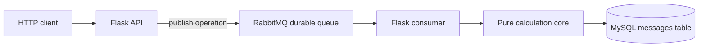

# Flask + RabbitMQ + MySQL Operations Service

A small production-oriented service that accepts arithmetic operations over HTTP, publishes them to RabbitMQ, consumes them, calculates the result, and persists the processed message in MySQL.

## Architecture



The arithmetic core is deliberately isolated from external services. This makes correctness and failure behavior testable without requiring RabbitMQ or MySQL in unit tests.

## Technology

- Python 3.11
- Flask and Flask-SQLAlchemy
- RabbitMQ with durable `operations` queue
- MySQL 8.4 through PyMySQL
- Docker Compose
- Gunicorn
- pytest, coverage, Flake8, Black, and Bandit

## Run with Docker Compose

```bash
cp .env.example .env
# Edit .env and replace all example passwords before use.
docker compose up --build
```

The service is available at `http://localhost:8000`. RabbitMQ management is available at `http://localhost:15672` using the values in `.env`.

The Compose stack uses `depends_on` health checks for MySQL and RabbitMQ. The MySQL data directory is stored in the named `mysql-data` volume.

## Run locally

```bash
python3 -m venv .venv
. .venv/bin/activate
pip install -r requirements-dev.txt
cp .env.example .env
# For a local-only run, set SQLALCHEMY_DATABASE_URI to sqlite:///messages.db.
set -a && . ./.env && set +a
python run.py
```

## API

Health check:

```bash
curl http://localhost:8000/health
```

Publish an operation:

```bash
curl -X POST http://localhost:8000/publish \
  -H 'Content-Type: application/json' \
  -d '{"method":"sum","list":[8,4]}'
```

Supported methods are `sum`, `subtract`, `multiply`, and `divide`. The list must contain at least one numeric operand. Division by zero, unknown methods, and malformed request bodies are rejected rather than silently processed.

The consumer endpoint starts a long-running RabbitMQ consumer:

```bash
curl http://localhost:8000/consume
```

## Configuration

All service credentials are supplied through environment variables. `.env` is ignored by Git and `.env.example` contains placeholders only.

- `SQLALCHEMY_DATABASE_URI`
- `RABBIT_MQ_HOST`
- `RABBIT_MQ_PORT`
- `RABBIT_MQ_USER`
- `RABBIT_MQ_PASSWORD`
- `RABBIT_MQ_QUEUE`

Use a deployment secret manager rather than committing credentials to the repository.

## Tests and quality checks

```bash
pytest --cov=app --cov-report=term-missing
flake8 app tests run.py config.py
black --check app tests run.py config.py
bandit -r app -ll
```

GitHub Actions runs all four checks for pushes and pull requests to `main`.
